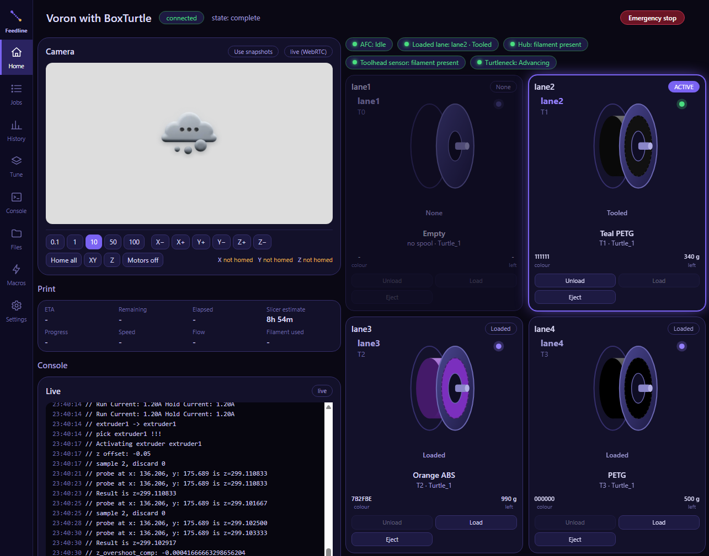
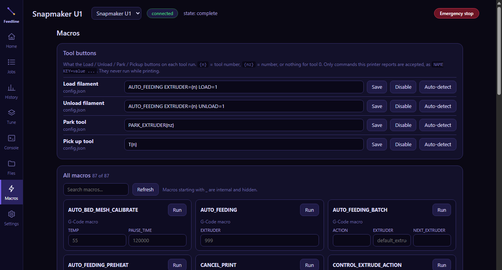
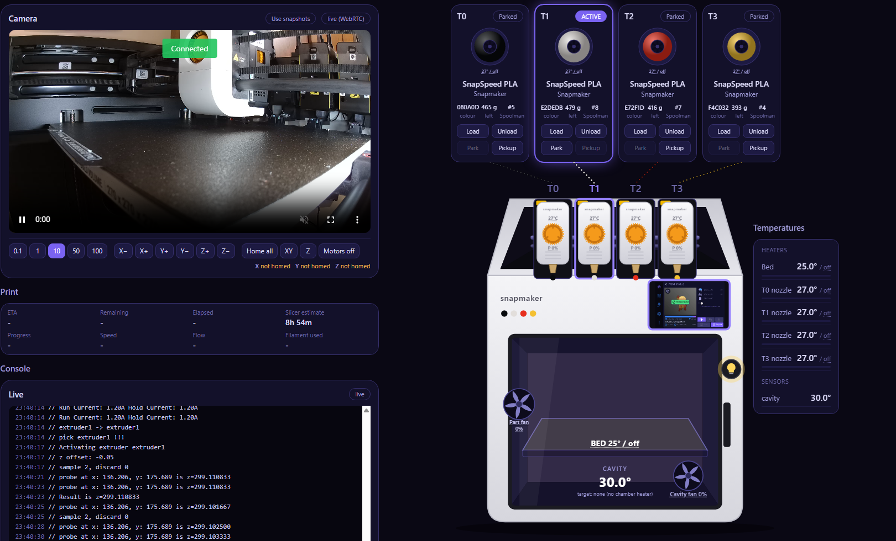
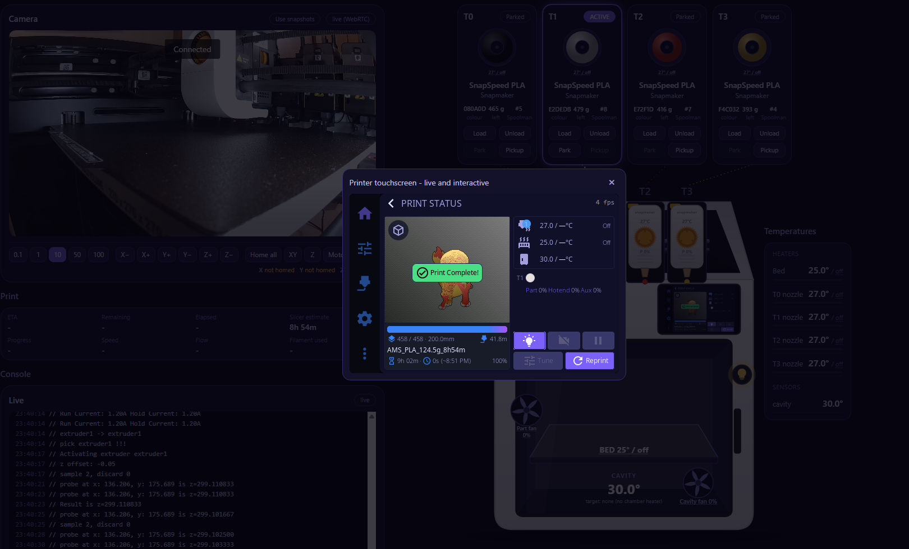
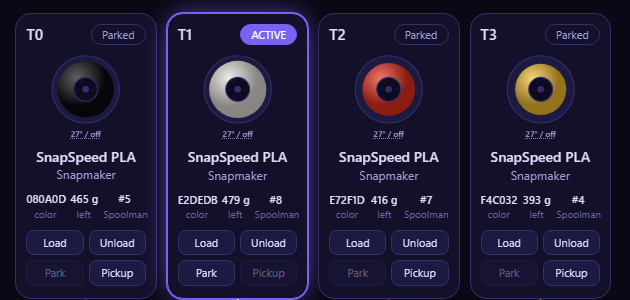
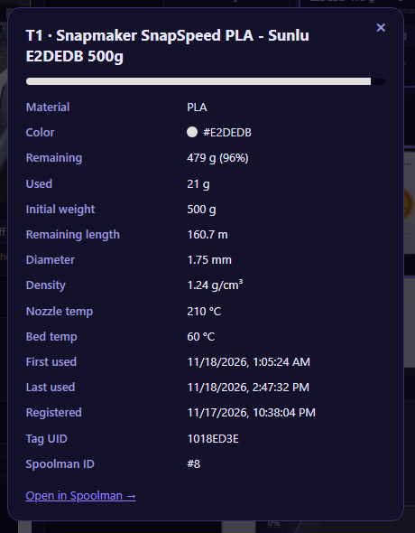
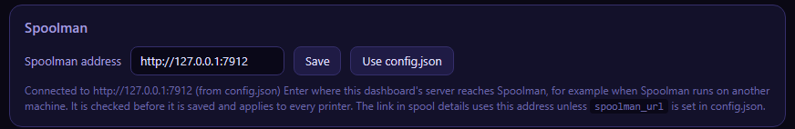
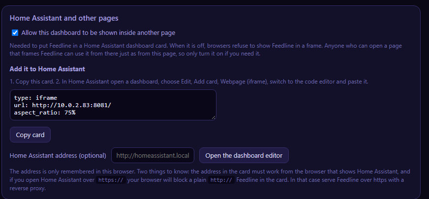

# Feedline: a Klipper printer dashboard

One HTML page (`feedline.html`, installed as `index.html`) plus a stdlib-only Python proxy (`feedline_server.py`).
Works with any Klipper + Moonraker printer; ships with a drawn Snapmaker U1 view, about 27 other drawn printer models (QIDI, Creality, Voron, RatRig, Sovol, Elegoo, Anycubic, Flashforge, Prusa, FLSUN) picked automatically, and a generic picture-based view.

**Features at a glance**
- Live view: camera (rotation and mirroring honored), temperatures, fans, chamber, job progress and thumbnail, moving toolhead and bed drawn from the printer's real position.
- Filament systems: Snapmaker U1 (RFID + Spoolman), AFC / BoxTurtle, QIDI Box, toolchangers (StealthChanger, klipper-toolchanger), or plain extruders. See [Filament systems](#filament-systems).
- [Print tuning](#print-tuning) while printing: Z offset, speed, flow, pressure advance. [Bed mesh](#tune-tab-bed-mesh) view with a Calibrate button.
- Android app with print notifications (finished, failed, cancelled, paused): see [Android app](#android-app-apk).
- Several printers: one instance, a Printers overview page, and a per-tab `?p=<id>` address so Home Assistant cards can each show a different printer.
- Remote touchscreen (Paxx firmware), Spoolman, a Home Assistant card helper, a Macros tab and a read-only config file browser.

*Home on a Snapmaker U1: the printer is drawn live from its state. Each tool card feeds a colored line down to its toolhead, the active tool is highlighted, and temperatures, fans, bed and chamber are clickable.*

*With AFC / BoxTurtle: status pills (AFC state, loaded lane, hub, toolhead sensor, Turtleneck) and a card per lane. Shown with the drawn U1 against a simulated AFC printer.*

*Settings > Graphics: printer picture, toolchanger graphic and spool style are chosen independently.*

*Macros: edit what the Load / Unload / Park / Pickup buttons run, or run any user macro.*

## Remote touchscreen (Snapmaker U1 with the Paxx firmware)

If your U1 runs [paxx12's SnapmakerU1 Extended Firmware](https://github.com/paxx12-snapmaker-u1/SnapmakerU1-Extended-Firmware) with its **Remote Screen** option turned on (in the firmware's config page), the printer serves its touchscreen at `http://<printer>/screen/`. Feedline uses that in two ways:

1. The screen on the drawn U1 shows a live picture of the real touchscreen (refreshed about once a second).
2. **Click the screen in the picture** (it gets a purple outline when you hover) and a window opens with the live, interactive touchscreen: you can tap it from the browser just like at the printer. Close it with the x.

*Top: the live screen in the drawn U1. Bottom: the interactive window, showing the printer's own print-status page.*

**To turn it on:** open **Settings > Printer options**, tick **Remote touchscreen**, and use **Check the printer** to confirm the printer serves it. No file editing needed.

(Advanced: the same can be set in `config.json` with `"screen": {"snapshot": "/screen/snapshot", "interactive": "/screen/"}`; a choice made in Settings overrides it.)

Notes:
- It is off until you tick it: the screen on the picture is not clickable otherwise.
- The window loads `http://<printer>/screen/` straight from your browser, so the browser must be able to reach the printer, not just Feedline's server. The live picture on the drawn screen goes through Feedline.
- The window is a real remote control: taps are sent to the printer. Like the rest of Feedline it has no login, so anyone who can open the dashboard can use it.
- The generic printer picture has a screen area too, so any printer that serves its screen at `/screen/` can use this.

## Spoolman on the Snapmaker U1

Feedline reads your [Spoolman](https://github.com/Donkie/Spoolman) spools and shows them on the U1's tool cards. Each card gets the spool's name, brand, color, **remaining weight** and its Spoolman number (`#8`), so you see how much filament is left on every tool at a glance.

**How a tool is matched to a spool.** The U1 reads the RFID tag on each spool and reports its UID. Feedline looks for that UID in the `card_uids` field of your Spoolman spools. A tag with no matching spool still works: the card shows what the tag itself says (type, brand, weight) and the spool popup says "Not in Spoolman".

**Click a spool** (on its card) to open its details: material, color, remaining / used / initial weight, remaining length, empty-spool weight, diameter, density, nozzle and bed temperature, price, location, lot, first / last used, comment, the tag UID and a link that opens the spool in Spoolman.

**Set it up**
1. In Spoolman add a **text** extra field for spools with the key `card_uids` (Spoolman > Settings > Extra Fields > Spool).
2. In Feedline open **Settings > Spoolman** and enter the address your *Feedline server* reaches Spoolman at, for example `http://192.168.1.20:7912`. It is checked against Spoolman before it is saved and applies to every printer. The link in the popup uses the same address unless `spoolman_url` in `config.json` says otherwise (useful when browsers reach Spoolman under a different name).
3. Get your spools into Spoolman with their tag UIDs in `card_uids`: either let the **auto-add helper** below do it, or enter them by hand (several tags can be separated by commas; the UID is shown in the spool popup, also for tags Spoolman does not know yet).

### Auto-add helper (optional)

`tools/spoolman_autoadd.py` watches the U1's loaded tags. When it sees a tag that no Spoolman spool has in `card_uids`, it creates the vendor, filament and spool from the tag's data (type, brand, color, weight, temperatures), stores the UID, and runs `SET_SPOOL_ID` so the printer links that tag to the new spool (held back while a print is running). It never edits or deletes existing spools. Python standard library only.

Install it together with Feedline (needs `"spoolman"` set in `config.json`, e.g. `"192.168.1.20:7912"`):

    sudo ./install.sh --with-autoadd

or run it yourself on any machine that can reach the printer (port 7125) and Spoolman:

    python3 tools/spoolman_autoadd.py --printer 192.168.1.50 --spoolman http://192.168.1.20:7912
    python3 tools/spoolman_autoadd.py --config /opt/feedline/config.json --dry-run --once     # only report, change nothing

The service uses the `printer` and `spoolman` from `config.json` (an address set in Settings is not used by it). It was tested against a simulated printer and Spoolman (creates vendor, filament and spool, binds the channel, adds nothing twice) and with a read-only `--dry-run` against a real U1 and Spoolman. The Spoolman side is plain REST calls (`/api/v1/vendor`, `/filament`, `/spool`).

Notes:
- The dashboard itself only **reads** Spoolman. Creating spools for new tags is the job of the optional auto-add helper above; nothing here changes existing spools or weights.
- Color, material and weight come from Spoolman when the tag is matched, and from the tag otherwise.
- This tag matching is for Snapmaker U1 printers (filament system "Snapmaker U1"). Other printers show Moonraker's active Spoolman spool on the active tool, or a fixed spool per tool set with `tool_spools` in `config.json`.
- Spoolman has no login either, so keep both on a trusted network.
## Where to run it

Feedline is one small Python process (it used about 20 MB of memory on the test setup) that sits between your browser and your printers. It has to be on a machine that is **always on** and can reach the printer. Recommended, best first:

| Where | Notes |
| --- | --- |
| **A small VM or LXC container** (Proxmox, ESXi, Hyper-V, a cloud-free home server) | Recommended. Debian or Ubuntu, 1 vCPU and a few hundred MB of RAM is plenty. Isolated from the printer, easy to snapshot, and a good place to run Spoolman and the auto-add helper too. This is how it was developed and tested. |
| **The machine that already runs Spoolman** | Same idea without a new VM: install it next to Spoolman. Then Spoolman's address is simply `127.0.0.1:7912`. |
| **A Raspberry Pi or other always-on Linux box** | Fine, including the Pi that runs Klipper and Moonraker for a non-Snapmaker printer. Not tested on every board, but it needs only Python 3.8+ and systemd. |
| **A Windows or Mac PC** | Works for trying it out (`python feedline_server.py ...`, see Run), but `install.sh` and the service file are Linux only, and the dashboard is down whenever the PC sleeps. |
| **On the printer itself** | Not recommended. On the Snapmaker U1 the system is rebuilt on every boot, so an install would not survive without changing how the printer boots, memory is tight (about 500 MB free when idle), and a firmware update can wipe it. On a Klipper Pi it is fine (see above). |

**Network requirements**
- **Feedline server to printer:** TCP 7125 (Moonraker). Also TCP 80 on the printer for the touchscreen picture, if you use the remote screen.
- **Feedline server to Spoolman:** the Spoolman port (default 7912), if you use Spoolman. The auto-add helper needs the same two connections.
- **Your browser to Feedline:** TCP 8081 (or the `--port` you chose).
- **Your browser to the printer** (directly, not through Feedline): for the live camera stream and the interactive touchscreen window. The camera also works in snapshot mode without this.
- If printers and servers are on different VLANs or subnets, open those paths in your firewall. A VM on a separate VLAN is fine as long as it can reach the printer and Spoolman.

**Tips**
- Give the machine a fixed address (DHCP reservation) so bookmarks keep working.
- Feedline has no login, so keep the VM on your home network or put it behind a reverse proxy that handles sign-in and HTTPS (see [SECURITY.md](SECURITY.md)). If a reverse proxy runs on the same machine, start Feedline with `--bind 127.0.0.1`.
- To show it inside Home Assistant, see [Home Assistant](#home-assistant) below (one toggle in Settings).
- Several printers? One Feedline instance handles them all (Settings > Printers).

## Home Assistant

Feedline can be shown as a card on a Home Assistant dashboard. No file editing is needed:

1. Open **Settings > Home Assistant and other pages** and tick **Allow this dashboard to be shown inside another page**.
2. Press **Copy card**. It copies a ready-made card using the address you are browsing from:

       type: iframe
       url: http://192.168.1.60:8081/
       aspect_ratio: 75%

3. In Home Assistant open a dashboard, choose Edit > Add card > Webpage (iframe), switch to the code editor and paste. Optionally type your Home Assistant address into the card's address box and press **Open the dashboard editor** to jump straight to the edit view.

Notes:
- Leave the toggle off if you do not need it: while it is off, browsers refuse to show Feedline inside any other page. While it is on, any page can frame it, which matters because Feedline has no login (see [SECURITY.md](SECURITY.md)).
- The address in the card is opened by the browser that shows Home Assistant, so it must be reachable from there (a name or IP, not `localhost`).
- If you open Home Assistant over `https://`, browsers block a plain `http://` Feedline in the card (mixed content). Put Feedline behind an https reverse proxy in that case.
- **Serving Feedline over https (reverse proxy).** Any reverse proxy works (Nginx Proxy Manager, NPMplus, Caddy, Traefik). Point a hostname that has a certificate your browsers trust at `http://<feedline-ip>:8081`, then use `url: https://<that hostname>/` in the card. Minimal Caddy example (automatic certificates on a public domain):

      feedline.example.com {
          reverse_proxy 192.168.1.60:8081
      }

  Minimal nginx server block (use your own certificate and key; pass the Host header through):

      server {
        listen 443 ssl;
        server_name feedline;
        ssl_certificate     /path/feedline.crt;
        ssl_certificate_key /path/feedline.key;
        location / {
          proxy_pass http://192.168.1.60:8081;
          proxy_set_header Host $host;
        }
      }

  On a home network without a public domain, create a local DNS name (for example `feedline`) pointing at the proxy and sign its certificate with a local CA that your devices trust. If the name has dots and is not `.local`, `.lan` or similar, add it to `allowed_hosts`. If the proxy runs on the same machine, start Feedline with `--bind 127.0.0.1`. The live camera and touchscreen window are loaded by your browser straight from the printer over http, so an https page may block them (mixed content); this is not yet verified.
- With several printers, give each card its printer in the address: `url: http://192.168.1.60:8081/?p=<id>` (see Settings > Printers). Without `?p=` a framed Feedline shows the printer picked last in that browser, which some browsers do not remember inside a frame. Buttons that ask first (Load, Home, Pause, Emergency stop...) use an in-page dialog, so they also work inside a card.
- The setting can also be preset with `allow_embed` in `config.json`; the toggle in Settings overrides it.

## Install as an app (Android, iPhone, desktop)

Feedline is an installable web app (PWA), so it gets its own icon and a full-screen window with no browser bar:

- **Android (Chrome):** open Feedline, then menu (three dots) > **Install app** (or **Add to Home screen**).
- **iPhone / iPad (Safari):** Share > **Add to Home Screen**.
- **Desktop Chrome / Edge:** the install icon in the address bar.

Chrome only offers a real install when the page is served over **https** (or from `localhost`) and your phone trusts the certificate, so set up the [reverse proxy](#home-assistant) first. Over plain `http://` you can still use "Add to Home Screen", which makes a shortcut that opens in the browser. The app shows live data only; if the server cannot be reached it shows a short "not reachable" page. It does not run in the background, so it cannot send notifications (for print-finished alerts use Home Assistant's phone app). Away from home the phone needs a VPN such as Tailscale, since Feedline has no login and should not be exposed to the internet.

### Android app (APK)

If you do not want to set up https, build the small Android app in [`android/`](android). It is a full-screen WebView around your Feedline server (about 17 KB, no dependencies), so updates to Feedline show up without reinstalling it:

- First start asks for the server address (for example `http://192.168.1.60:8081/`). Plain `http://` works, so the camera and touchscreen window keep working. Long-press the app icon > **Change server address** to change it later; if the server cannot be reached the app offers Retry and Change address.
- Back button goes back in the dashboard, the screen stays on while it is open, file pickers (graphics uploads), downloads (log export) and confirm dialogs work.
- Build (Windows, needs a JDK 11+ and the Android SDK with `platforms;android-34` and `build-tools;35.0.0`): `powershell -File android\build.ps1 -Sdk C:\path\to\android-sdk`. It writes `android/feedline.apk`, signed with a key it creates in `%USERPROFILE%\.android\feedline.jks` (keep that file: a new key cannot update an app installed with the old one). Copy the APK to the phone, open it, and allow installs from that source.
- **Print notifications:** the app shows a notification when a print finishes, fails, is cancelled or pauses, for every printer Feedline knows. Tapping one opens that printer. Allow notifications when Android asks, and switch them on or off in Feedline's Settings (the **Phone notifications** card only appears inside the app). No Google services or outside server are involved: the server watches the printers (read-only) and the app keeps one small connection open to your Feedline server, so it works on your home network or over a VPN, not from the internet. Android may delay alerts while the phone sleeps; the app offers once to be excluded from battery optimization to prevent that. It restarts itself after a reboot. Set `"events": false` in `config.json` to turn the server-side watching off.
- Tested in an Android 14 emulator (installs, address dialog, permission prompt, finished and failed notifications from a stand-in printer). Not tried on a physical phone, and the Settings switch inside the app, tapping a notification and the battery prompt have not been tried.

## Install (Linux, about two minutes)

Requirements: Python 3.8+ (nothing to `pip install`), and a Klipper printer whose Moonraker answers on port 7125 from this machine.

    git clone https://github.com/Squallzz/feedline.git && cd feedline
    sudo ./install.sh 192.168.1.50              # your printer's address

The script copies the files to `/opt/feedline`, writes `config.json`, installs the hardened
`feedline.service` (dynamic user, read-only filesystem, state in `/var/lib/feedline`) and starts it. Open `http://192.168.1.60:8081/ (your server's address)`.

Manual install: copy `feedline.html` to `/opt/feedline/index.html`, `feedline_server.py` and `graphics/` next to it, copy `config.example.json`
to `/opt/feedline/config.json` and set `printer`, then run the command below, or copy `feedline.service` to `/etc/systemd/system/`
and `systemctl enable --now feedline`.

Update: re-run `sudo ./install.sh` from a newer copy (config and settings are kept). Uninstall: `systemctl disable --now feedline`,
delete `/etc/systemd/system/feedline.service`, `/opt/feedline` and `/var/lib/feedline`.

Troubleshooting: `journalctl -u feedline -e`. "unknown host name" (HTTP 421) means you opened the page by a DNS name the server does not know:
add it to `allowed_hosts`. A blank printer page means Moonraker is unreachable from this machine (`curl http://192.168.1.50:7125/server/info`).

## Run

    python3 feedline_server.py --port 8081 --root /opt/feedline --state /var/lib/feedline [--bind 127.0.0.1]

`--root` holds `index.html`, `graphics/` and `config.json`. `--state` must be writable: it holds UI settings, uploaded
graphics, the printers added in the UI, and backups of edited config files. Never restarts Klipper or Moonraker.

## config.json (admin only, edited on the server)

See `config.example.json`. Only `printer` is required. Anything the browser could abuse is deliberately file-only:

| key | meaning |
| --- | --- |
| `printer` | Moonraker host (port 7125) |
| `name` | header text (can also be changed in Settings) |
| `allowed_hosts` | extra Host names the server answers to (anti DNS-rebinding). IP addresses, single-label names and `.local/.lan/.home.arpa/.internal/.ts.net` always work |
| `allow_embed` | optional; normally use Settings > Home Assistant and other pages. `true` lets another site show the page in a frame (e.g. a Home Assistant card); default refuses framing |
| `allow_config_edit` | `false` makes the Files tab read-only |
| `spoolman`, `spoolman_url` | Spoolman the server talks to (`host:port` or a URL such as `http://192.168.1.20:7912`, so it can run on any machine, not just this one), and the URL browsers open (defaults to the same address). Can also be set in Settings > Spoolman, which overrides this and is checked against Spoolman's `/api/v1/info` before saving |
| `provider` | `auto`, `u1` (Snapmaker RFID tags matched in Spoolman) or `extruders` (one slot per extruder; spool from `tool_spools` or Moonraker's active spool) |
| `tools` | number of tools; null = count extruders |
| `macros` | buttons per tool: `load`, `unload`, `park`, `pickup`. `{n}` = tool number, `{nz}` = number or empty for tool 0. Actions you leave out are auto-detected (`auto_macros: false` turns that off); `""` disables one |
| `light` | optional; normally use Settings > Printer options. `{"object","on","off"}` G-code for the light button; left out, an LED or light-named pin is found automatically; `false` hides the button |
| `screen` | optional; normally use Settings > Printer options. `{"snapshot","interactive"}` paths of the printer's remote touchscreen page, e.g. `/screen/snapshot` and `/screen/` |
| `webcam` | `{"mode","live","snapshot"}`; null = first webcam Moonraker reports |
| `tool_fans` | per tool `{"hotend": "heater_fan ...", "part": "fan_generic ..."}` for the overlays |
| `chamber` | `{"sensor","fan"}`; found by name when omitted |

## Settings tab

- **Name** shown at the top.
- **Printers**: add more printers (name + IP/hostname). The server checks that Moonraker answers, rejects loopback/link-local
  addresses, and stores them in `printers.json`. Added printers use the generic setup (no custom macros). A header drop-down
  switches printers. The first printer comes from `config.json` and cannot be removed in the UI.
  Each printer has its own address: `http://<feedline>:8081/?p=<id>` (`?p=main` for the first one; the id is shown next to each
  printer in the list and appears in the address bar after switching). A tab keeps the printer it was opened with, so two tabs,
  or two cards on a Home Assistant dashboard, can show different printers at the same time. Without `?p=` the page opens the
  printer picked last in that browser (cookie `printer`). Commands are queued per printer, and config-file backups are kept
  per printer.
- **Printers page**: with two or more printers a **Printers** entry appears in the left bar. It shows one card per printer:
  state, the running file with progress, layer, time left and finish time, nozzle and bed temperatures, the camera picture
  (or the printer's drawing when it has no camera) and the job's thumbnail. It refreshes every few seconds, shows a printer
  that does not answer as offline without holding up the others, and has no controls: click a card to open that printer.
- **Printer options**: tick **Remote touchscreen**, and choose which LED the **Light button** switches (Automatic finds one by name; or pick another / hide it). **Camera picture** turns the camera the right way up: rotation in quarter turns, mirror left-right, flip top-bottom. It starts from the printer's own webcam settings in Moonraker (the ones Mainsail and Fluidd use) and applies to live video and snapshots; a change here is kept for this dashboard only. Per printer.
- **Moving toolhead and bed** (under Graphics): on by default; untick it for a still printer drawing. The fans keep spinning either way. `"motion": false` in `config.json` presets it.
- **Graphics**: three independent choices, per printer: the printer picture, the toolchanger graphic (the 3D BoxTurtle unit, or none) and the spool graphic (the filament roll on each tool/lane card: spool wheel, simple reel, 3D spool, none, or your own SVG). With AFC, a dotted line in the loaded filament's color runs from the active lane to the toolhead.
- **Drawn printer models**: the printer graphic is picked automatically from what Klipper reports (kinematics, build volume, vendor-specific config sections and paths, host name) and shown as "Automatic: <model>" with the reason next to it. There are drawings for QIDI (Plus4, X-Max 3, X-Plus 3, Q1 Pro, Q2, X-Smart 3), Creality (K1, K1 Max, K2 Plus, Ender-3), Voron (2.4, Trident, 0, Switchwire), RatRig V-Core, Sovol (SV08, SV06 / SV07), Elegoo Neptune 4, Anycubic (Kobra S1, Kobra 2 / 3), Flashforge Adventurer 5M, Prusa MK3 / MK4 running Klipper, FLSUN deltas, and four brand-neutral shapes (enclosed CoreXY, open-frame CoreXY, bed slinger, delta). They are simplified original drawings, not product art. The toolhead follows the real X position; the bed (or the gantry, on a Voron 2.4 or a bed slinger) follows Z, and while a print with a thumbnail runs the nozzle rides on top of the growing part. Only the QIDI Plus4 and Voron 2.4 were checked against real printers; the brand detection for the others is a best guess, so pick another graphic if it is wrong. Printers with several tools show one marker per tool instead of a moving head.
- **Upload a printer graphic** (PNG/JPEG/WebP/SVG, 3 MB): click or drag anchors on the picture: `bed`, `chamber`, `screen`
  (areas), `chamberTemp`, `partFan`, `chamberFan`, `light` (points) and one point per tool. All optional.
- **Upload a toolchanger graphic** (one SVG per slot). Optional hooks on any element:
  `data-fill="filament"`, `data-stroke="filament"`, `data-heat="1"`, `data-level="scale|height|width"`,
  `data-text="temp|target|tool|material|name|remaining|fan"`, `data-show="loaded|empty|active|idle|heating"`.
  Scripts, event handlers, external links and global CSS are stripped; ids are prefixed.

Feedline has no login. Anyone who can open the page can use the controls, add printers and edit config files, so run it only on a network you trust, or put it behind a reverse proxy that handles authentication and TLS. See [SECURITY.md](SECURITY.md).

## Filament systems

Settings > Filament system: auto-detect, standard (one filament per extruder), Snapmaker U1 (RFID tags) or **AFC / BoxTurtle** (ArmoredTurtle). When a printer is added the server looks for the AFC objects (`AFC` plus `AFC_stepper`/`AFC_lane` lanes) and sets it up automatically. With AFC the cards are one per lane, drawn as a 3D spool, and underneath them a 3D BoxTurtle unit (black frame, gold lattice panels, one bay per lane with the spool loaded, levers, color LED bars; more than one unit is stacked), and each lane card has three buttons: Unload (`TOOL_UNLOAD`), Load (`TOOL_LOAD`; if another lane is already loaded to the toolhead it first runs the Unload macro for that lane, so Load swaps filament) and Eject (`LANE_UNLOAD`), all with `LANE={lane}` (`CHANGE_TOOL` is detected but not shown as a button) (`{lane}` is available in custom macros too). A row of status pills above the cards shows AFC's state, the toolhead/extruder filament sensor (`AFC_extruder`), the hub (`AFC_hub`) and the Turtleneck buffer (`AFC_buffer`); pills only appear for what the printer reports. Click a spool (on its card or in the BoxTurtle picture) to edit the lane's material, color and weight: the server sends `SET_MATERIAL`, `SET_COLOR` and `SET_WEIGHT` with `LANE=<lane>` (only values that pass validation, only if your AFC version reports those commands; this changes AFC's lane data, not Spoolman). Changing the system also switches the filament graphic back to that system's default. AFC support was built from the AFC source code and tested against a simulated AFC printer, not real BoxTurtle hardware.

**QIDI Box.** A printer with a QIDI Box (`box_stepper slot0` ... objects) is detected automatically and gets one card per Box slot, named as on the printer's screen (`1A` to `1D`, `2A` ... for a second Box). Each card shows the slot's state (In use, Ready, Empty) and the material, color and vendor set for that slot on the printer, read from the `multi_color_controller` object; firmware without that object still gives the states through the saved variables, and the names are then looked up in the printer's `officiall_filas_list.cfg`. A last card, **External**, is the spool that bypasses the Box and is loaded by hand (the printer's `slot16`): it shows the material set for it on the printer and counts as in use when the toolhead has filament and no Box slot is loaded into it, since nothing senses that spool itself. It has no Load or Unload button. A status row shows the Box connection, the loaded slot, the toolhead filament sensor and the Box's temperature, humidity and drying target. A dotted line in the filament's color runs from the slot in use to the toolhead. Load and Unload send what QIDI's own Fluidd "Control Box" card sends, `E_LOAD slot=<n>` and `E_UNLOAD slot=<n>` (`<n>` is the slot number), so the Box firmware runs its whole sequence (heat, cut, retract, purge). **Eject** (Fluidd's "Uninstall", `E_BOX slot=<n>`) pulls a filament that is waiting in the Box back out of its slot. Load and Eject are live for a slot whose filament is waiting, Unload for the slot in the toolhead; all three are idle only and act without a confirmation question, as on the printer's own Box card. To use other macros instead, set them in the Macros tab or in `config.json` (`{n}` is the slot number). For a spool without an RFID tag, click the spool and use **Set this slot** to choose its filament, color and vendor from the printer's own filament table (`officiall_filas_list.cfg`); the server stores the chosen rows in the Box's saved variables (`filament_slot<n>`, `color_slot<n>`, `vendor_slot<n>`), as the printer's own Box card does, and only when no print is running. This also works for the External spool. The Box does not weigh spools, so there is no remaining amount. Read-only parts were checked against a real Plus4 with one Box; the Load and Unload buttons were not pressed on a real printer, and two or more Boxes are untested.

**Toolchangers (StealthChanger, klipper-toolchanger, ktc-easy).** A printer with a `toolchanger` object and `tool T0` ... objects (viesturz's klipper-toolchanger, which StealthChanger and klipper-toolchanger-easy use) is detected automatically. Each tool gets a card showing Active or Docked; a status row shows the toolchanger's state (Ready, Changing, Error, Uninitialized), the tool in use and, with tool detection, the tool detected. Pickup runs `T{n}` (or `SELECT_TOOL T={n}` when the tools have no numbers) and Park runs `UNSELECT_TOOL`, idle only. On a cube-shaped drawn printer the tools hang in a row of docks at the top and the one in use rides the gantry. **Settings > Graphics** has the **Toolhead** look (Generic, Stealth Burner, Mini Stealth Burner, Dragon Burner, Rapid Burner, AntHead, Yavoth, A4T, XOL, Jabberwocky, Archetype BlackBird; simplified shapes, also used for a single-tool printer's head) and the number of **Docks** (one per tool by default, up to 12; spare docks are drawn empty). `toolhead` and `docks` in `config.json` preset them. This was built from the klipper-toolchanger source and documentation and checked with simulated printer state only, not on a real toolchanger; one toolhead look applies to every tool.

## Print tuning

The **Print tuning** card on Home (under Print) is for adjusting a running print:

- **Z offset** (baby-stepping): pick a step (0.005, 0.01, 0.025 or 0.05 mm), then **Closer** or **Further**; **Reset** goes back to 0. The server refuses a step that would take the total offset beyond `z_offset_limit` in `config.json` (default 1.0 mm).
- **Speed** (10 to 200 %) and **Flow** (50 to 150 %) sliders with 100 % in the middle, and a button back to 100 %.
- **Pressure advance** (0 to 2) and its **smooth time** (0 to 0.2 s), for the tool in use.

Unlike moves and tool changes these are allowed while printing; that is what they are for. Each request is range-checked on the server and turned into one fixed command (`SET_GCODE_OFFSET Z_ADJUST=`, `M220`, `M221`, `SET_PRESSURE_ADVANCE`). Nothing is saved on the printer: after a restart it is back to its configured values. The commands were checked as text and the read-out against a running printer; they were not sent to a real print.

## Tune tab: bed mesh

The **Tune** tab shows the loaded bed mesh as a heatmap and a 3D surface. **Calibrate bed mesh** runs `BED_MESH_CALIBRATE` on the printer (after a confirmation) and then reloads the picture. It works on every printer that has that command, and only when the printer is idle and all axes are homed; otherwise the server refuses and says why. Heat the bed first if your printer needs it. The new mesh stays in the printer's memory only: saving it needs `SAVE_CONFIG`, which restarts Klipper, so run that on the printer (Feedline never restarts Klipper). The probing takes a few minutes and cannot be stopped from here. Checked with a stand-in printer, not on real hardware.

## Macros tab

Lists every user-facing macro (names not starting with `_`) with its description and parameters (read from the printer's config) and a Run button (idle only, confirmation first). The tool-button macros (load/unload/park/pickup) are auto-detected from the printer's macros and commands; in the same tab each can be changed, disabled or reset to auto-detect. Custom values are limited to `NAME KEY=value` for commands the printer reports (restart/shutdown/save-config style commands are refused), never free-form G-code. Precedence: custom (UI) > config.json > auto-detected.

## Tests

    python -m unittest discover -s tests -v

`tests/test_server.py` covers the server's decisions that need no printer: model detection, filament-system detection, the command each tool button builds, print-tuning limits, heater caps, macro parameters, and the path and address checks. Standard library only; printer answers are faked and nothing opens a network connection. The page has no automated tests.

## Not covered

Happy Hare multi-material units have no provider yet (the interface is `slotsU1` / `slotsAFC` / `slotsExtruders` in the page).
Tested on real printers: the Snapmaker U1, a QIDI Plus4 with one QIDI Box and a Voron 2.4 (mostly read-only). Simulated only: AFC / BoxTurtle, toolchangers, and the detection of other printer brands. Other printers' macros and objects are untested.
