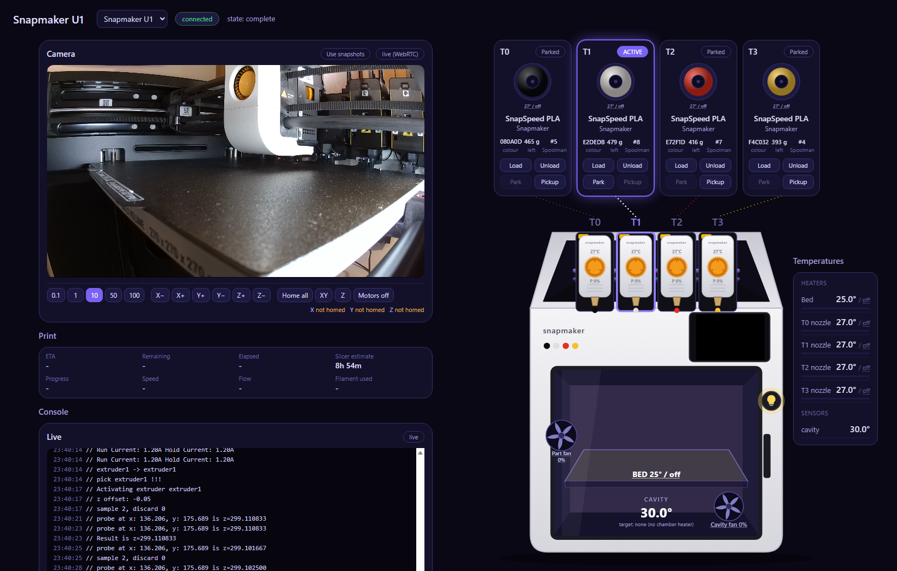
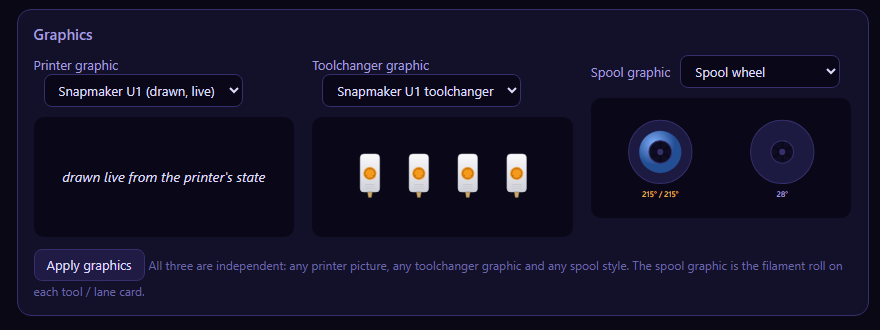
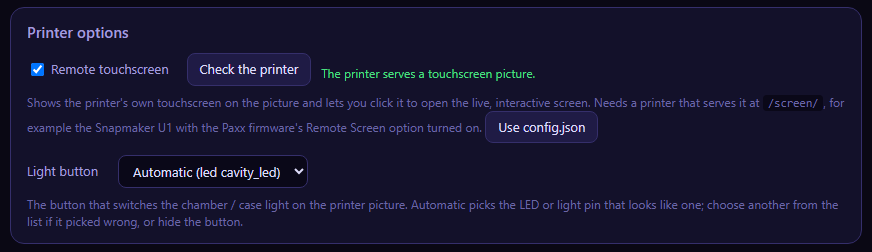

# Feedline: a Klipper printer dashboard

One HTML page (`feedline.html`, installed as `index.html`) plus a stdlib-only Python proxy (`feedline_server.py`).
Works with any Klipper + Moonraker printer; ships with a drawn Snapmaker U1 view and a generic picture-based view.

*Home on a Snapmaker U1: the printer is drawn live from its state. Each tool card feeds a coloured line down to its toolhead, the active tool is highlighted, and temperatures, fans, bed and chamber are clickable.*

*With AFC / BoxTurtle: status pills (AFC state, loaded lane, hub, toolhead sensor, Turtleneck) and a card per lane. Shown with the drawn U1 against a simulated AFC printer.*

*Settings > Graphics: printer picture, toolchanger graphic and spool style are chosen independently.*

*Macros: edit what the Load / Unload / Park / Pickup buttons run, or run any user macro.*

## Remote touchscreen (Snapmaker U1 with the Paxx firmware)

If your U1 runs [paxx12's SnapmakerU1 Extended Firmware](https://github.com/paxx12-snapmaker-u1/SnapmakerU1-Extended-Firmware) with its **Remote Screen** option turned on (in the firmware's config page), the printer serves its touchscreen at `http://<printer>/screen/`. Feedline uses that in two ways:

1. The screen on the drawn U1 shows a live picture of the real touchscreen (refreshed about once a second).
2. **Click the screen in the picture** (it gets a purple outline when you hover) and a window opens with the live, interactive touchscreen: you can tap it from the browser just like at the printer. Close it with the x.

*Top: the live screen in the drawn U1. Bottom: the interactive window, showing the printer's own print-status page.*

**To turn it on:** open **Settings > Printer options**, tick **Remote touchscreen**, and use **Check the printer** to confirm the printer serves it. No file editing needed.

(Advanced: the same can be set in `config.json` with `"screen": {"snapshot": "/screen/snapshot", "interactive": "/screen/"}`; a choice made in Settings overrides it.)

Notes:
- It is off until you tick it: the screen on the picture is not clickable otherwise.
- The window loads `http://<printer>/screen/` straight from your browser, so the browser must be able to reach the printer, not just Feedline's server. The live picture on the drawn screen goes through Feedline.
- The window is a real remote control: taps are sent to the printer. Like the rest of Feedline it has no login, so anyone who can open the dashboard can use it.
- The generic printer picture has a screen area too, so any printer that serves its screen at `/screen/` can use this.

## Install (Linux, about two minutes)

Requirements: Python 3.8+ (nothing to `pip install`), and a Klipper printer whose Moonraker answers on port 7125 from this machine.

    git clone https://github.com/Squallzz/feedline.git && cd feedline
    sudo ./install.sh 192.168.1.50              # your printer's address

The script copies the files to `/opt/feedline`, writes `config.json`, installs the hardened
`feedline.service` (dynamic user, read-only filesystem, state in `/var/lib/feedline`) and starts it. Open `http://192.168.1.60:8081/ (your server's address)`.

Manual install: copy `feedline.html` to `/opt/feedline/index.html`, `feedline_server.py` and `graphics/` next to it, copy `config.example.json`
to `/opt/feedline/config.json` and set `printer`, then run the command below, or copy `feedline.service` to `/etc/systemd/system/`
and `systemctl enable --now feedline`.

Update: re-run `sudo ./install.sh` from a newer copy (config and settings are kept). Uninstall: `systemctl disable --now feedline`,
delete `/etc/systemd/system/feedline.service`, `/opt/feedline` and `/var/lib/feedline`.

Troubleshooting: `journalctl -u feedline -e`. "unknown host name" (HTTP 421) means you opened the page by a DNS name the server does not know:
add it to `allowed_hosts`. A blank printer page means Moonraker is unreachable from this machine (`curl http://192.168.1.50:7125/server/info`).

## Run

    python3 feedline_server.py --port 8081 --root /opt/feedline --state /var/lib/feedline [--bind 127.0.0.1]

`--root` holds `index.html`, `graphics/` and `config.json`. `--state` must be writable: it holds UI settings, uploaded
graphics, the printers added in the UI, and backups of edited config files. Never restarts Klipper or Moonraker.

## config.json (admin only, edited on the server)

See `config.example.json`. Only `printer` is required. Anything the browser could abuse is deliberately file-only:

| key | meaning |
| --- | --- |
| `printer` | Moonraker host (port 7125) |
| `name` | header text (can also be changed in Settings) |
| `allowed_hosts` | extra Host names the server answers to (anti DNS-rebinding). IP addresses, single-label names and `.local/.lan/.home.arpa/.internal/.ts.net` always work |
| `allow_embed` | `true` lets another site show the page in a frame (e.g. a Home Assistant card); default refuses framing |
| `allow_config_edit` | `false` makes the Files tab read-only |
| `spoolman`, `spoolman_url` | Spoolman the server talks to (`host:port` or a URL such as `http://192.168.1.20:7912`, so it can run on any machine, not just this one), and the URL browsers open (defaults to the same address). Can also be set in Settings > Spoolman, which overrides this and is checked against Spoolman's `/api/v1/info` before saving |
| `provider` | `auto`, `u1` (Snapmaker RFID tags matched in Spoolman) or `extruders` (one slot per extruder; spool from `tool_spools` or Moonraker's active spool) |
| `tools` | number of tools; null = count extruders |
| `macros` | buttons per tool: `load`, `unload`, `park`, `pickup`. `{n}` = tool number, `{nz}` = number or empty for tool 0. Actions you leave out are auto-detected (`auto_macros: false` turns that off); `""` disables one |
| `light` | optional; normally use Settings > Printer options. `{"object","on","off"}` G-code for the light button; left out, an LED or light-named pin is found automatically; `false` hides the button |
| `screen` | optional; normally use Settings > Printer options. `{"snapshot","interactive"}` paths of the printer's remote touchscreen page, e.g. `/screen/snapshot` and `/screen/` |
| `webcam` | `{"mode","live","snapshot"}`; null = first webcam Moonraker reports |
| `tool_fans` | per tool `{"hotend": "heater_fan ...", "part": "fan_generic ..."}` for the overlays |
| `chamber` | `{"sensor","fan"}`; found by name when omitted |

## Settings tab

- **Name** shown at the top.
- **Printers**: add more printers (name + IP/hostname). The server checks that Moonraker answers, rejects loopback/link-local
  addresses, and stores them in `printers.json`. Added printers use the generic setup (no custom macros). A header drop-down
  switches printers (cookie `printer`). The first printer comes from `config.json` and cannot be removed in the UI.
- **Printer options**: tick **Remote touchscreen**, and choose which LED the **Light button** switches (Automatic finds one by name; or pick another / hide it). Per printer.
- **Graphics**: three independent choices, per printer: the printer picture, the toolchanger graphic (the 3D BoxTurtle unit, or none) and the spool graphic (the filament roll on each tool/lane card: spool wheel, simple reel, 3D spool, none, or your own SVG). With AFC, a dotted line in the loaded filament's colour runs from the active lane to the toolhead.
- **Upload a printer graphic** (PNG/JPEG/WebP/SVG, 3 MB): click or drag anchors on the picture: `bed`, `chamber`, `screen`
  (areas), `chamberTemp`, `partFan`, `chamberFan`, `light` (points) and one point per tool. All optional.
- **Upload a toolchanger graphic** (one SVG per slot). Optional hooks on any element:
  `data-fill="filament"`, `data-stroke="filament"`, `data-heat="1"`, `data-level="scale|height|width"`,
  `data-text="temp|target|tool|material|name|remaining|fan"`, `data-show="loaded|empty|active|idle|heating"`.
  Scripts, event handlers, external links and global CSS are stripped; ids are prefixed.

Feedline has no login. Anyone who can open the page can use the controls, add printers and edit config files, so run it only on a network you trust, or put it behind a reverse proxy that handles authentication and TLS. See [SECURITY.md](SECURITY.md).

## Filament systems

Settings > Filament system: auto-detect, standard (one filament per extruder), Snapmaker U1 (RFID tags) or **AFC / BoxTurtle** (ArmoredTurtle). When a printer is added the server looks for the AFC objects (`AFC` plus `AFC_stepper`/`AFC_lane` lanes) and sets it up automatically. With AFC the cards are one per lane, drawn as a 3D spool, and underneath them a 3D BoxTurtle unit (black frame, gold lattice panels, one bay per lane with the spool loaded, levers, colour LED bars; more than one unit is stacked), and each lane card has three buttons: Unload (`TOOL_UNLOAD`), Load (`TOOL_LOAD`; if another lane is already loaded to the toolhead it first runs the Unload macro for that lane, so Load swaps filament) and Eject (`LANE_UNLOAD`), all with `LANE={lane}` (`CHANGE_TOOL` is detected but not shown as a button) (`{lane}` is available in custom macros too). A row of status pills above the cards shows AFC's state, the toolhead/extruder filament sensor (`AFC_extruder`), the hub (`AFC_hub`) and the Turtleneck buffer (`AFC_buffer`); pills only appear for what the printer reports. Click a spool (on its card or in the BoxTurtle picture) to edit the lane's material, colour and weight: the server sends `SET_MATERIAL`, `SET_COLOR` and `SET_WEIGHT` with `LANE=<lane>` (only values that pass validation, only if your AFC version reports those commands; this changes AFC's lane data, not Spoolman). Changing the system also switches the filament graphic back to that system's default. AFC support was built from the AFC source code and tested against a simulated AFC printer, not real BoxTurtle hardware.

## Macros tab

Lists every user-facing macro (names not starting with `_`) with its description and parameters (read from the printer's config) and a Run button (idle only, confirmation first). The tool-button macros (load/unload/park/pickup) are auto-detected from the printer's macros and commands; in the same tab each can be changed, disabled or reset to auto-detect. Custom values are limited to `NAME KEY=value` for commands the printer reports (restart/shutdown/save-config style commands are refused), never free-form G-code. Precedence: custom (UI) > config.json > auto-detected.

## Not covered

Happy Hare multi-material units have no provider yet (the interface is `slotsU1` / `slotsAFC` / `slotsExtruders` in the page).
Only the U1, the generic path and a simulated AFC printer were tested; other printers' macros and objects are untested.
